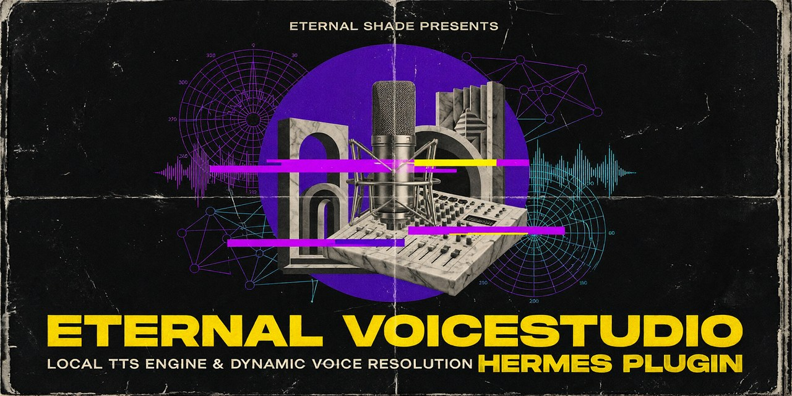
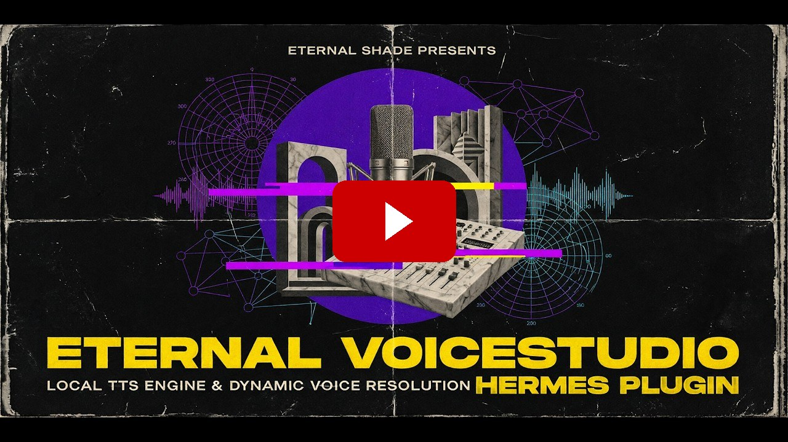
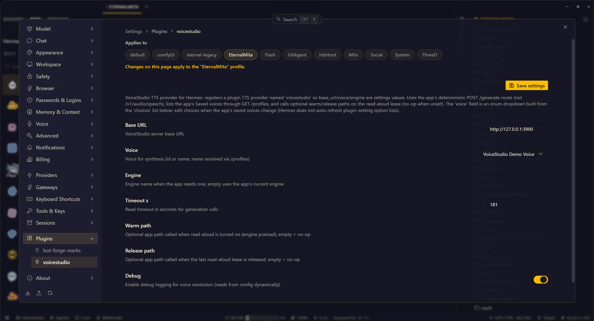

# VoiceStudio Hermes plugin

<div align="center">

<a href="https://github.com/EternalShade3D/voicestudio-hermes-plugin/releases/latest"></a>
<a href="https://github.com/EternalShade3D/voicestudio-hermes-plugin/blob/main/LICENSE"></a>
<a href="https://github.com/EternalShade3D/voicestudio-hermes-plugin"></a>
<a href="https://github.com/EternalShade3D/voicestudio-hermes-plugin"></a>



</div>

VoiceStudio is a local text-to-speech app. This plugin lets Hermes Agent speak its replies using **your own voices** from VoiceStudio.

Connect **VoiceStudio** to your **Hermes Agent** to enable realistic, custom local text-to-speech for your bot responses without scripts or manual voice IDs.

> **Why `voicestudio-tts`?** The plain `voicestudio` plugin id belongs to a different project, a tool client for the same VoiceStudio app. This one registers a Hermes TTS provider, so it ships under its own id and the two can live side by side.

- **Voice by name:** Pick a voice you saved in VoiceStudio by name. Run `/voicestudio` to list them, `/voicestudio <name>` to set one. `/voicestudio refresh` writes those names into `plugin.yaml`, which is what turns the settings field into a list.
- **Per-Profile Setup:** Give different Hermes profiles distinct voices.
- **Zero Scripting Required:** Fully integrated UI configuration and commands.

---

## How to install the plugin in Hermes Desktop

<div align="center">

[](https://youtu.be/qGd0liG_6vk)

<a href="https://youtu.be/qGd0liG_6vk"></a>

*Click above to watch the setup video.*

</div>

### UI Overview



---

## Prerequisites

Ensure the following before installation:

- [x] **VoiceStudio** is running locally on your machine.
- [x] You have at least **one custom voice** saved in VoiceStudio.
- [x] **Hermes Agent** `v0.21` or newer.

> **Note:** The plugin queries VoiceStudio live over HTTP (`127.0.0.1:3900`). If VoiceStudio isn't running, available voices cannot be fetched.

---

## Installation

Choose your preferred installation method:

### Option A: Hermes Desktop (Recommended)

1. Open **Hermes Desktop**.
2. Navigate to **Capabilities → Plugins → Install from Git**.
3. Paste repo URL: `https://github.com/EternalShade3D/voicestudio-hermes-plugin.git`
4. Select your target profile and confirm installation.
5. Make it the active provider: **Settings → Voice → Text to speech → Text-To-Speech Provider → VoiceStudio**.
6. Start **VoiceStudio**, then in any chat run `/voicestudio refresh` so the plugin reads your saved voices and writes the dropdown list.
7. Pick your voice: **Capabilities → Plugins → VoiceStudio → Voice** dropdown, or run `/voicestudio <name>`.

Plugin settings hold the advanced options (server URL, engine, timeout, cache retention). The provider picker lives in the Voice settings, not in the plugin panel.

---

### Option B: Command Line (CLI)

#### 1. Clone into Plugins Folder
Default profile path is `~/.hermes/plugins/`. For a custom profile, target `~/.hermes/profiles/<profile_name>/plugins/`.

* **Linux / macOS:**
  ```bash
  git clone https://github.com/EternalShade3D/voicestudio-hermes-plugin.git ~/.hermes/plugins/voicestudio-tts
  ```

* **Windows (PowerShell):**
  ```powershell
  git clone https://github.com/EternalShade3D/voicestudio-hermes-plugin.git "$env:USERPROFILE\.hermes\plugins\voicestudio-tts"
  ```

* **Manual (No Git):** Download the `.zip` archive, extract contents to a folder named `voicestudio-tts`, and place it inside your `plugins/` directory.

#### 2. Enable & Select Provider

```bash
hermes plugins enable voicestudio-tts
hermes config set tts.provider voicestudio-tts
```

---

## Configuration & Usage

1. Ensure VoiceStudio is open.
2. In Hermes, fetch your local voice library:
   ```bash
   /voicestudio refresh
   ```
3. Select your voice:
   - **Via GUI:** **Capabilities → Plugins → VoiceStudio → Voice**. Until `/voicestudio refresh` runs, this field is plain text; after it, your saved voices appear as a dropdown list.
   - **Via Command:** run `/voicestudio <voice_name>` in chat.

That's it. Your bot now speaks with the voice you picked.

### Speech Options
- **On-Demand:** Click **Read aloud** under any specific bot response.
- **Continuous:** Enable **Read replies aloud** in the desktop app settings to auto-speak every response.

Spoken audio is saved in the cache of the profile running the bot, `~/.hermes/profiles/<profile>/cache/audio`, or `$HERMES_HOME/cache/audio` when `HERMES_HOME` is set. Each bot keeps its own cache, so two bots do not share audio.

Retention defaults to **100 MB per profile**: when the cache grows past that, the oldest clips are deleted first. Change it with `tts.keep_generated_audio_max_mb`, or turn saving off entirely with `tts.keep_generated_audio: false` (audio is then deleted right after it plays).

---

## Commands Reference

| Command | Description |
| :--- | :--- |
| `/voicestudio` | Displays current voice settings and available local voices. |
| `/voicestudio <name>` | Quickly switches the active voice profile by name. |
| `/voicestudio refresh` | Re-scans VoiceStudio and saves the names. With `sync_dropdown: true` it also writes them into `plugin.yaml` so the Settings voice list updates. Run it when you add a voice in the app. |

---

## Settings Reference

| Key | Default Value | Description |
| :--- | :--- | :--- |
| `base_url` | `http://127.0.0.1:3900` | Local API server endpoint for VoiceStudio. |
| `voice` | *(User choice)* | Voice name or ID. Plain text until `/voicestudio refresh` writes `choices` into `plugin.yaml`, then it renders as a dropdown. |
| `engine` | *(Empty)* | Specific TTS engine override if required by your setup. |
| `timeout_s` | `180` | Audio generation request timeout in seconds. |
| `warm_path` / `release_path` | *(Empty)* | Optional hooks triggered before/after read-aloud requests. |
| `sync_dropdown` | `false` | **On:** your voices appear in the Settings voice list, picked with the mouse. The plugin then rewrites its own `plugin.yaml`, so the installed folder shows as changed. **Off (default):** the folder is never touched, you pick with `/voicestudio <name>`. |
| `debug` | `false` | Enables verbose debug logging for voice resolution. |

### Audio cache (Hermes `tts.` settings)

| Key | Default | Description |
| :--- | :--- | :--- |
| `keep_generated_audio` | `true` | Keep read-aloud audio in the profile cache instead of deleting it right after playback. |
| `keep_generated_audio_max_mb` | `100` | Total cache size per profile. Oldest clips are pruned first. |

---

> [!WARNING]
> If you previously configured an older command-bridge setup, remove the legacy override from your `config.yaml`:
> ```bash
> hermes config unset tts.providers.voicestudio
> ```

---

## License

This project is licensed under the [MIT License](LICENSE).
